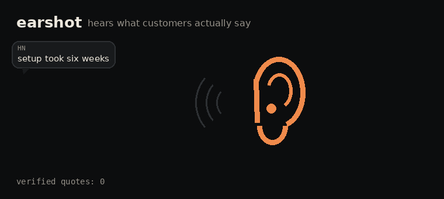

# Earshot 👂

[](https://github.com/ishacm/earshot/actions/workflows/ci.yml)


**Paste a website. Hear what its customers actually say.**

Earshot reads public reviews and discussions about a product and its competitors, finds the pains people keep repeating, and turns them into messaging. Every quote is checked word for word against its source, so nothing is made up.

<p align="center"></p>

**👉 [See it in action](https://ishacm.github.io/earshot/)** · **[Open the demo report](https://ishacm.github.io/earshot/demo/report.html)**

---

## What it does, in plain words

1. **You give it a website.** It works out what the company sells and who its competitors are.
2. **It listens.** It collects what real people say in public about the product, its competitors and the problem they solve.
3. **It tells you what matters.** Which pains come up again and again, what makes people hesitate, why they switch, and how to say all of that in your messaging.

## What you get

- **Messaging:** a positioning line, three headline options and three message pillars, each linked to real quotes.
- **What people struggle with:** top pains, jobs to be done and objections, counted by how many people mention them.
- **Battlecards:** for each competitor, where they win and where they lose.
- **The gap:** what your website promises that nobody talks about, and what customers care about that your website never mentions.

It works for any startup people talk about online: SaaS, dev tools, consumer apps.

## Try it in 60 seconds

No account, no API key, no cost:

```bash
git clone https://github.com/ishacm/earshot && cd earshot
pip install -r requirements.txt
EARSHOT_LLM=mock python -m earshot.run --demo
```

Then open the `report.html` it prints. The demo uses a fictional company, *Ledgerly*, and made-up comments, so it shows the format, not real findings.

## Use it on a real company

```bash
cp .env.example .env        # paste a free Groq key from console.groq.com
python -m earshot.run --url https://some-company.com --competitors "Rival A, Rival B"
```

Want more than public comments? Add your own export (G2 reviews, support tickets, NPS answers) with `--csv my_reviews.csv`.

---

<details>
<summary><b>How it works, step by step</b></summary>

| Step | What happens |
|---|---|
| **1. Read the website** | Finds the company, category, the claims it makes and likely competitors (you can override them) |
| **2. Collect** | Hacker News and App Store reviews (free, public APIs), Reddit (with your own key), and your CSV files. Usernames, emails and phone numbers are removed |
| **3. Tag** | Each mention gets tagged as a pain, job, objection, praise, reason to switch or feature request, with an exact quote. Paraphrased quotes are rejected and counted |
| **4. Count, then write** | Themes are counted in code, so the numbers are reproducible. The AI writes messaging from numbered evidence only, and anything uncited is dropped |
| **5. Report** | A shareable web page, a Markdown file, and an optional Slack summary |

</details>

<details>
<summary><b>Run it every week with n8n</b></summary>

Start the small local API, then import [`n8n/earshot.workflow.json`](n8n/earshot.workflow.json) into a self-hosted n8n (free Community Edition):

```bash
uvicorn earshot.serve:app --port 8090                                    # n8n on the same machine
EARSHOT_API_TOKEN=pick-a-long-random-string \
  uvicorn earshot.serve:app --host 0.0.0.0 --port 8090                   # n8n in Docker: always set a token
```

The workflow runs Earshot on demand (via a webhook) or every Monday, and posts a summary to Slack. Paste your token and your Slack webhook URL into the nodes.

</details>

<details>
<summary><b>What it costs (nothing) and what keeps it honest</b></summary>

| Piece | Free option |
|---|---|
| AI | Groq free tier. Paid models are blocked unless you set `EARSHOT_ALLOW_PAID=true` |
| Sources | Hacker News, App Store and Reddit official APIs, plus your own CSV files. No scraping of sites that forbid it |
| Automation | n8n Community Edition, self-hosted |

- **Quotes are exact or they're gone.** The report shows how many were rejected.
- **Counts are honest.** They are mentions in this sample, not market share, and themes with fewer than 3 mentions are marked weak.
- **No secrets in the code.** Keys live in `.env`, which is never committed, and CI fails if anything key-shaped slips in.
- **Before you quote a number:** check 30 tagged mentions by hand, and keep the report's date and sources with any figure you share.

</details>

<details>
<summary><b>What's in the repo</b></summary>

```
earshot/     the pipeline: profile, collect, tag, synthesize, report, serve (API for n8n)
  sources/   hackernews, appstore, reddit, csv
prompts/     the three prompts
fixtures/    the fictional demo company
n8n/         the importable workflow
docs/        the live page, the demo report and the animation (python docs/make_gifs.py)
tests/       21 tests, run on every push without keys or network
```

</details>

---

<sub>MIT licensed · built by [Isha Chaudhari](https://www.linkedin.com/in/ishachaudhari/) · one of three small open GTM tools: [Kompass](https://github.com/ishacm/kompass), [Earshot](https://ishacm.github.io/earshot/) and [crm-tidy](https://ishacm.github.io/crm-tidy/)</sub>
